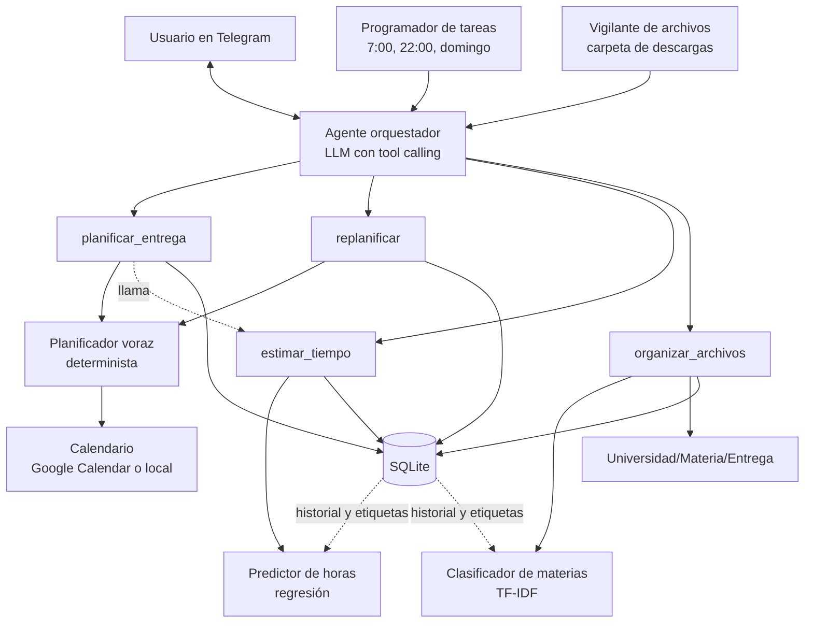

# E.D.I.T.H.
### Estudiante Dirigido por Inteligencia, Tareas y Horarios

> *"Even Dead, I'm The Hero."*

En *Spider-Man: Lejos de casa*, Tony Stark le deja a Peter Parker unas gafas con
**E.D.I.T.H.**, una inteligencia artificial capaz de ver todo, anticiparse y actuar
por él. Peter tenía que salvar el mundo; nosotros solo tenemos que sobrevivir al
semestre. Pero el problema se parece más de lo que crees: demasiadas cosas pasando
al mismo tiempo y muy poco control sobre ellas.

Este proyecto nace en la materia de **Inteligencia Artificial**, cuyo reto era
resolver una problemática real mediante un **agente inteligente con herramientas
y skills**. Elegimos la que vivimos todos los días: perder el control
del
cronograma académico. Entregas que llegan sin avisar, planes que se
rompen el
primer día, informes "de 2 horas" que terminan tomando 5, y archivos
perdidos
entre Descargas, Drive y el correo.

**E.D.I.T.H. es nuestra respuesta:** un agente que no solo te recuerda
las cosas,
sino que dirige tu semestre como un orquestador:

- 📅 **Planea** cada entrega hacia atrás y reserva bloques de trabajo en tu Google Calendar.
- 🧠 **Predice** cuánto te vas a demorar *de verdad*, con un modelo de ML entrenado sobre tu historial.
- 📁 **Organiza** tus archivos por materia con un clasificador entrenado.
- 🔁 **Corrige el rumbo** cada noche: si te atrasaste, reacomoda tu semana y te avisa qué entregas están en riesgo.

## Cómo trabaja

Se le habla por Telegram y actúa sobre el calendario, la carpeta de archivos y una base de datos propia. Un mismo bot atiende a varios estudiantes: cada uno se registra desde el chat, conecta su Moodle y tiene su propia base de datos, sus archivos y su memoria de conversación. Cada frente tiene su skill:

| Frente | Skill | Qué hace |
|---|---|---|
| Planear | `planificar_entrega` | Divide una entrega en subtareas y las agenda en los huecos libres del calendario, de la fecha límite hacia atrás |
| Predecir | `estimar_tiempo` | Usa un modelo entrenado para estimar cuántas horas reales tomará cada subtarea |
| Organizar | `organizar_archivos` | Clasifica cada archivo nuevo por materia con un modelo entrenado, lo mueve y lo vincula a su entrega |
| Corregir el rumbo | `replanificar` | Detecta lo que no se hizo, reacomoda la semana y avisa qué entregas quedan en riesgo |

Una conversación típica:

> **Tú:** El viernes 27 entrego el taller 3 de Sistemas Operativos, vale 15 %, es sobre semáforos. Creo que son unas 4 horas.
>
> **E.D.I.T.H.:** Te reservé 5 bloques entre el miércoles y el jueves. Estimaste 4 h, pero para este tipo de trabajo lo esperado son 7,5 h: las tareas de código suelen tomar un 80 % más de lo previsto.

El sistema se retroalimenta: lo que realmente tardas vuelve al historial y el modelo de tiempos se reentrena cada semana.

## Arquitectura



Cada pieza hace lo que mejor sabe hacer:

| Tarea | Responsable | Razón |
|---|---|---|
| Entender lo que escribe el usuario y elegir el skill | LLM | Lenguaje natural y razonamiento |
| Dividir una entrega en subtareas | LLM | Requiere entender el enunciado |
| Estimar horas | Modelo de regresión | Aprende del historial y es medible |
| Clasificar archivos | Modelo de clasificación (LLM si hay duda) | Rápido y sin costo |
| Asignar bloques y calcular el riesgo | Algoritmo determinista | Debe respetar las restricciones siempre |
| Redactar avisos y proponer opciones | LLM | Comunicación y criterio |

## Modelos

Los dos modelos se entrenan con scikit-learn. Cada uno tiene su notebook con el pipeline completo: datos, preprocesamiento, entrenamiento, validación y métricas.

| Modelo | Algoritmo elegido | Resultado en el conjunto de prueba |
|---|---|---|
| Predictor de tiempo (`notebooks/02`) | Gradient Boosting | MAE de 1,09 h frente a 2,36 h de la línea base; R² de 0,81 |
| Clasificador de archivos (`notebooks/03`) | Naive Bayes sobre TF-IDF | Accuracy de 0,994 y F1 macro de 0,994 en 44 materias |

**Sobre los datos.** Estos resultados se obtuvieron con datos sintéticos: tiempos generados con reglas explícitas (`ml/datos_sinteticos.py`) y documentos de práctica armados con el vocabulario de cada materia (`ml/corpus_sintetico.py`). Sirven para dejar funcionando el pipeline y el agente, pero no miden el desempeño con datos reales, que será menor. El proyecto está preparado para reemplazarlos:

- **Tiempos:** la encuesta descrita en [`docs/encuesta.md`](docs/encuesta.md) se guarda en `data/encuesta_tiempos.csv` y entra sola al entrenamiento.
- **Archivos:** cada vez que el clasificador duda y el usuario confirma la materia, ese archivo queda como ejemplo etiquetado para el siguiente reentreno.
- **Uso propio:** cada subtarea terminada agrega una fila real al historial.

## Instalación

Requisitos: Python 3.12 o superior y Git. Funciona en Linux y en Windows.

```bash
git clone https://github.com/CamiloMutis/E.D.I.T.H..git edith
cd edith
```

Linux o macOS:

```bash
python3 -m venv .venv
source .venv/bin/activate
pip install -r requirements.txt
cp .env.example .env
```

Windows (PowerShell):

```powershell
py -m venv .venv
.venv\Scripts\Activate.ps1
pip install -r requirements.txt
copy .env.example .env
```

Si PowerShell bloquea la activación, ejecuta antes `Set-ExecutionPolicy -Scope CurrentUser RemoteSigned`.

## Configuración

Todo el proyecto funciona sin costo. Las llaves van en el archivo `.env`, que nunca se sube al repositorio.

1. **Telegram.** Habla con [@BotFather](https://t.me/BotFather), envía `/newbot` y copia el token en `TELEGRAM_BOT_TOKEN`.
2. **LLM.** Crea una llave gratuita en [console.groq.com](https://console.groq.com) y cópiala en `GROQ_API_KEY`. Recomendado: crea también una llave gratuita de Gemini en [aistudio.google.com/apikey](https://aistudio.google.com/apikey) y ponla en `GEMINI_API_KEY`; si Groq llega a su límite, E.D.I.T.H. sigue con Gemini sin que el estudiante lo note y vuelve a Groq a los 5 minutos. Si tienes llave de Claude o de GPT, puedes usarlas con `LLM_PROVIDER=anthropic` u `openai`.
3. **Administrador.** Pon tu id de Telegram (te lo da [@userinfobot](https://t.me/userinfobot)) en `TELEGRAM_ADMIN_ID`: tendrás `/admin`, `/anuncio` y `/reentrenar` y te llegarán los avisos de errores.
4. **Google Calendar (opcional, solo modo consola).** En [Google Cloud Console](https://console.cloud.google.com) crea un proyecto, habilita Google Calendar API, crea una credencial OAuth de tipo "Aplicación de escritorio" y guarda el archivo como `credentials.json` en la raíz. La primera ejecución abre el navegador para autorizar. Sin este archivo, E.D.I.T.H. usa un calendario local guardado en SQLite.
5. **Reglas.** En `config.yaml` se ajustan el semestre, las horas máximas de estudio por día, la franja horaria, el margen antes de cada entrega y las carpetas. En Windows y en Linux la carpeta de descargas por defecto es `~/Downloads`.

Las materias salen del pénsum de Ingeniería de Sistemas (`data/pensum.json`). Al arrancar quedan activas las del semestre indicado en `config.yaml`; se cambia en cualquier momento con `/semestre N`.

## Uso

```bash
python main.py
```

Cada estudiante le escribe `/start` al bot y E.D.I.T.H. lo guía en un minuto:

1. Le explica qué datos guarda y pide que acepte (proyecto académico, Ley 1581 de 2012).
2. Le pregunta el semestre.
3. Le pide su usuario y su contraseña de Moodle. **La contraseña se usa una sola vez** para pedirle a Moodle un permiso de acceso (token); el mensaje con la contraseña se borra del chat y solo queda el token, cifrado con `EDITH_CLAVE_MAESTRA`. Se puede saltar y conectar después con `/conectar_moodle`.

Desde ahí se le habla en lenguaje natural o con comandos:

| Comando | Qué hace |
|---|---|
| `/hoy` | Plan del día: bloques, entregas de la semana y archivos relacionados |
| `/pendientes` | Entregas abiertas con su nivel de riesgo |
| `/revisar_dia` | Pregunta cómo te fue con los bloques de hoy y reorganiza la semana |
| `/moodle` | Revisa Moodle ahora: tareas nuevas, fechas cambiadas y lo que está por vencer |
| `/calendario` | Envía tu plan (bloques, entregas y vencimientos de Moodle) como archivo `.ics` para Google Calendar u Outlook |
| `/semestre N` · `/materias` | Cambia el semestre y, con él, las materias activas |
| `/pausar` | Pausa resúmenes, revisiones y avisos de Moodle: `/pausar`, `/pausar 3h`, `/pausar 2d`, `/pausar 1s`, `/pausar hasta 30/11` |
| `/reanudar` | Vuelve a enviar avisos y revisa Moodle de inmediato |
| `/ajustes` | Horas de estudio por día, hora del resumen y de la revisión, horario de avisos de Moodle |
| `/estado` | Qué está conectado, si estás en pausa y cuántos mensajes llevas hoy |
| `/conectar_moodle` · `/desconectar_moodle` | Conecta, reconecta o borra el acceso a Moodle |
| `/mis_datos` | Descarga en un `.zip` todo lo que E.D.I.T.H. guarda de ti |
| `/olvidarme` | Borra tu cuenta, tus datos y tus archivos |

Sin que se lo pidas, E.D.I.T.H. envía a cada estudiante el resumen de la mañana y la revisión de la noche a la hora que eligió (por defecto 7:00 a. m. y 10:00 p. m.). Si el bot estuvo apagado a esa hora, lo envía al volver, hasta dos horas tarde. Los modelos se reentrenan cada domingo con lo que aportan todos los estudiantes. También organiza cualquier PDF, Word o PowerPoint que le envíes por el chat, en la carpeta de cada estudiante.

Para la prueba, cada estudiante tiene un tope de mensajes conversados al día (`bot.limite_mensajes_dia` en `config.yaml`, 80 por defecto); los comandos no cuentan. Con `EDITH_CODIGO_INVITACION` en `.env`, solo se registra quien conozca el código.

**Datos.** Todo queda en `data/` (o en `EDITH_DATOS`): `cuentas.db` con las cuentas, `usuarios/<id de Telegram>/` con la base y los archivos de cada estudiante, y `clave_maestra` si no definiste `EDITH_CLAVE_MAESTRA`. Si antes usabas E.D.I.T.H. solo, al arrancar tus entregas, tu plan y tu Moodle pasan a tu cuenta automáticamente.

### Vigilancia de Moodle

Para cada estudiante con Moodle conectado, E.D.I.T.H. revisa el calendario de Moodle cada 15 minutos dentro de su horario de avisos (6:00 a. m. a 10:00 p. m. por defecto) y avisa por Telegram cuando:

- un profesor publica una tarea nueva (y si aún no abre, desde cuándo se puede entregar),
- se abre una tarea o un quiz que estaba cerrado,
- cambia la fecha de una entrega,
- una entrega está a 72, 24 o 3 horas de vencer (cada aviso se envía una sola vez),
- el profesor sube contenido nuevo al curso (diapositivas, lecturas…) con la opción "notificar cambio de contenido".

Además, **todo lo que hay en Moodle queda planeado solo**: cada tarea o quiz sin entregar se registra como entrega, se divide en subtareas y recibe bloques de estudio, sin tener que dictárselo. Si cambia la fecha se reacomoda y, al entregar, se liberan sus bloques. Se desactiva con `moodle.planear_entregas: false` en `config.yaml`. `/pendientes` muestra todo agrupado por materia, con la fecha y lo que falta para cada entrega.

Consulta el estado de cada entrega: **lo que ya entregaste no se recuerda** (en quices, cuenta un intento terminado), avisa si dejaste un borrador sin enviar y confirma una vez cuando detecta que entregaste. Si el acceso deja de funcionar (por ejemplo, porque cambiaste la contraseña), avisa una vez y pide reconectar con `/conectar_moodle`.

Moodle no ofrece webhooks para estudiantes, por eso la detección es por consulta periódica, un estudiante a la vez para no saturar la plataforma. La primera revisión solo registra lo existente, sin anunciarlo como nuevo. La consulta en lenguaje natural ("¿qué tengo en Moodle esta semana?", "¿ya entregué el plan de pruebas?") también funciona desde el chat.

### Despliegue

Los avisos solo llegan mientras el bot está en marcha. La guía [`docs/despliegue.md`](docs/despliegue.md) explica, paso a paso, las opciones gratuitas: una VM gratuita de Google Cloud con Docker (`docker compose up -d --build`), Render en modo webhook (`EDITH_WEBHOOK_URL`) o tu propio computador. En un computador con Linux basta con el servicio de usuario de systemd:

```bash
scripts/servicio.sh instalar             # arranca ya y cada vez que inicias sesión
scripts/servicio.sh instalar --siempre   # además corre aunque no hayas iniciado sesión
scripts/servicio.sh estado               # ¿está corriendo?
scripts/servicio.sh logs                 # ver lo que está haciendo
scripts/servicio.sh desinstalar
```

Solo puede correr una copia del bot por token de Telegram: mientras el servicio o el contenedor corren, no ejecutes también `python main.py`.

### Sin Telegram

```bash
python main.py --consola
```

Abre una conversación con el agente en la terminal, para un solo usuario: usa la base de `config.yaml: base_de_datos` y las credenciales de Moodle de `.env`. Los comandos `/hoy`, `/pendientes`, `/revisar_dia` y `/archivo RUTA` funcionan incluso sin llave de LLM.

### Escenario de demostración

```bash
python scripts/preparar_demo.py
```

Crea `data/demo.db` con un horario de clases ficticio, dos entregas planificadas y un bloque sin hacer. Para usarlo, pon en `config.yaml` `base_de_datos: data/demo.db` y `calendario.backend: local`. Así la demo no toca tu calendario ni tus datos.

## Pruebas

```bash
pip install -r requirements-dev.txt
python -m pytest
```

Las pruebas cubren el planificador (día lleno, entrega imposible, bloques que no caben, tope diario, margen), los skills, la organización de archivos, el bucle del agente con un LLM simulado, los adaptadores de cada proveedor y el respaldo con Gemini, el bot sin conexión, el registro guiado, la pausa, las rutinas por estudiante, el cifrado del token de Moodle y que los datos de un estudiante no se vean desde otro. Se ejecutan en Linux y en Windows con cada cambio.

Para reentrenar los modelos desde cero y volver a generar las métricas:

```bash
python -m ml.entrenar --regenerar
```

## Estructura

```
├── main.py                   arranca el bot (polling o webhook) o la consola
├── arranque.py               ensambla el contexto del modo consola
├── usuarios.py               sesión de cada estudiante: su base, su Moodle y su agente
├── ajustes.py                lee config.yaml y .env
├── config.yaml               reglas del usuario
├── agente/
│   ├── orquestador.py        bucle del agente
│   ├── herramientas.py       esquemas JSON de los skills
│   ├── llm.py                adaptador común: Groq, Gemini, Claude y GPT, con respaldo automático
│   └── prompts.py            prompt de sistema y plantillas
├── skills/                   los cuatro skills y las herramientas de soporte
├── planificador/scheduler.py algoritmo voraz de asignación de bloques
├── integraciones/            Telegram, Google Calendar, calendario local, vigilante
├── ml/                       entrenamiento, modelos guardados y generación de datos
├── notebooks/                datos, predictor y clasificador, ejecutados con salidas
├── db/                       esquema SQL, acceso a datos y cuentas (token cifrado)
├── data/                     pénsum y datasets de arranque
├── docs/encuesta.md          formulario para recolectar datos reales
├── scripts/preparar_demo.py  escenario de demostración
├── scripts/servicio.sh       deja el bot corriendo como servicio de systemd
├── scripts/desplegar_vm.sh   instala y arranca el bot con Docker en una VM
├── Dockerfile, docker-compose.yml   imagen y despliegue con Docker
├── docs/despliegue.md        cómo desplegarlo gratis
└── tests/                    pruebas con pytest
```

## Limitaciones

- Los modelos incluidos están entrenados con datos sintéticos. Sus métricas no valen como resultado final hasta repetir el entrenamiento con la encuesta y con archivos reales.
- Los planes gratuitos de Groq y Gemini limitan las solicitudes por minuto y por día. Con las dos llaves, cuando Groq se agota sigue Gemini; si los dos se agotan, funcionan los comandos pero no la conversación.
- La base de datos es SQLite, una por estudiante. Alcanza para una prueba con decenas de estudiantes; para toda la universidad convendría PostgreSQL y varias instancias.
- En el servidor cada estudiante usa el calendario interno; a Google Calendar u Outlook llega con `/calendario` (un archivo que hay que volver a importar cuando cambia el plan), no con sincronización automática.
- Consultar Moodle con el acceso de los estudiantes debería acordarse con la oficina de TI de la universidad antes de un uso abierto.
- El planificador es voraz: encuentra un buen plan, no necesariamente el óptimo.
- Los PDF escaneados sin texto no se pueden clasificar por contenido; en ese caso pregunta.

## Mejoras futuras

- Leer el programa de cada materia y extraer fechas y porcentajes de forma automática.
- Calcular la nota necesaria en lo que falta del semestre y usarla en la prioridad.
- Notas de Moodle: "¿cómo voy en Redes?" y cuánto se necesita en el final.
- Descargar y organizar solo el material que suben los profesores.
- Mensajes de voz.
- Reemplazar el algoritmo voraz por un optimizador con restricciones (OR-Tools).
- Ajustar un modelo de tiempos personal sobre el modelo general.
