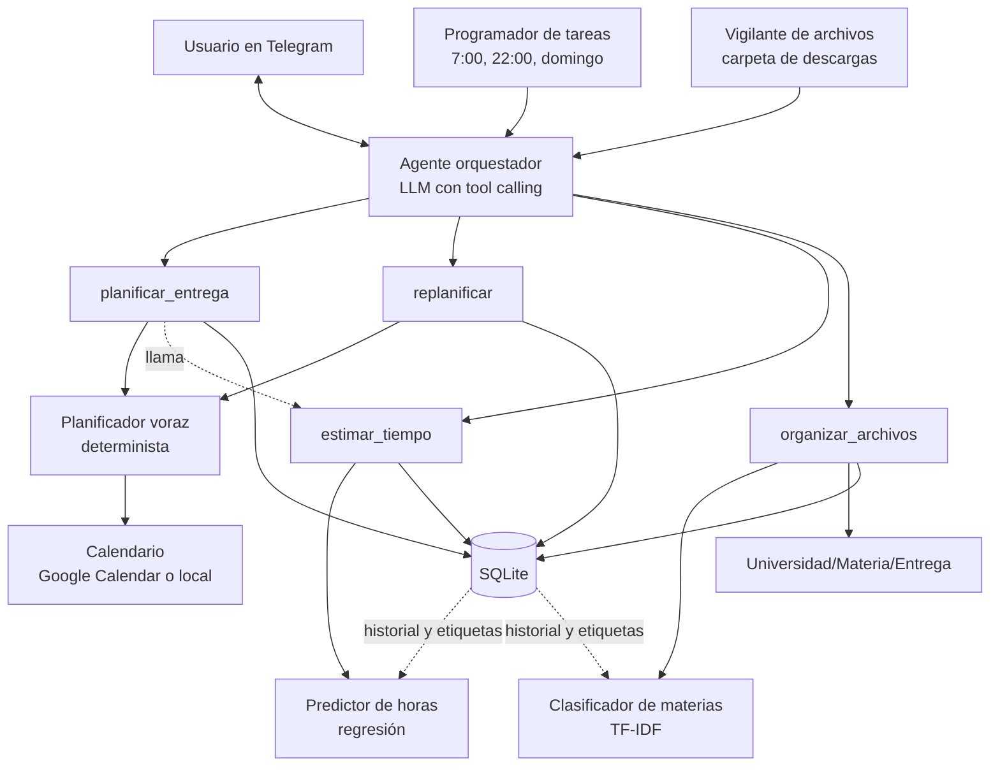

# E.D.I.T.H.
### Estudiante Dirigido por Inteligencia, Tareas y Horarios

> *"Even Dead, I'm The Hero."*

En *Spider-Man: Lejos de casa*, Tony Stark le deja a Peter Parker unas gafas con
**E.D.I.T.H.**, una inteligencia artificial capaz de ver todo, anticiparse y actuar
por él. Peter tenía que salvar el mundo; nosotros solo tenemos que sobrevivir al
semestre. Pero el problema se parece más de lo que crees: demasiadas cosas pasando
al mismo tiempo y muy poco control sobre ellas.

Este proyecto nace en la materia de **Inteligencia Artificial**, cuyo reto era
resolver una problemática real mediante un **agente inteligente con herramientas
y skills**. Elegimos la que vivimos todos los días: perder el control
del
cronograma académico. Entregas que llegan sin avisar, planes que se
rompen el
primer día, informes "de 2 horas" que terminan tomando 5, y archivos
perdidos
entre Descargas, Drive y el correo.

**E.D.I.T.H. es nuestra respuesta:** un agente que no solo te recuerda
las cosas,
sino que dirige tu semestre como un orquestador:

- 📅 **Planea** cada entrega hacia atrás y reserva bloques de trabajo en tu Google Calendar.
- 🧠 **Predice** cuánto te vas a demorar *de verdad*, con un modelo de ML entrenado sobre tu historial.
- 📁 **Organiza** tus archivos por materia con un clasificador entrenado.
- 🔁 **Corrige el rumbo** cada noche: si te atrasaste, reacomoda tu semana y te avisa qué entregas están en riesgo.

## Cómo trabaja

Se le habla por Telegram y actúa sobre el calendario, la carpeta de archivos y una base de datos propia. Cada frente tiene su skill:

| Frente | Skill | Qué hace |
|---|---|---|
| Planear | `planificar_entrega` | Divide una entrega en subtareas y las agenda en los huecos libres del calendario, de la fecha límite hacia atrás |
| Predecir | `estimar_tiempo` | Usa un modelo entrenado para estimar cuántas horas reales tomará cada subtarea |
| Organizar | `organizar_archivos` | Clasifica cada archivo nuevo por materia con un modelo entrenado, lo mueve y lo vincula a su entrega |
| Corregir el rumbo | `replanificar` | Detecta lo que no se hizo, reacomoda la semana y avisa qué entregas quedan en riesgo |

Una conversación típica:

> **Tú:** El viernes 27 entrego el taller 3 de Sistemas Operativos, vale 15 %, es sobre semáforos. Creo que son unas 4 horas.
>
> **E.D.I.T.H.:** Te reservé 5 bloques entre el miércoles y el jueves. Estimaste 4 h, pero para este tipo de trabajo lo esperado son 7,5 h: las tareas de código suelen tomar un 80 % más de lo previsto.

El sistema se retroalimenta: lo que realmente tardas vuelve al historial y el modelo de tiempos se reentrena cada semana.

## Arquitectura



Cada pieza hace lo que mejor sabe hacer:

| Tarea | Responsable | Razón |
|---|---|---|
| Entender lo que escribe el usuario y elegir el skill | LLM | Lenguaje natural y razonamiento |
| Dividir una entrega en subtareas | LLM | Requiere entender el enunciado |
| Estimar horas | Modelo de regresión | Aprende del historial y es medible |
| Clasificar archivos | Modelo de clasificación (LLM si hay duda) | Rápido y sin costo |
| Asignar bloques y calcular el riesgo | Algoritmo determinista | Debe respetar las restricciones siempre |
| Redactar avisos y proponer opciones | LLM | Comunicación y criterio |

## Modelos

Los dos modelos se entrenan con scikit-learn. Cada uno tiene su notebook con el pipeline completo: datos, preprocesamiento, entrenamiento, validación y métricas.

| Modelo | Algoritmo elegido | Resultado en el conjunto de prueba |
|---|---|---|
| Predictor de tiempo (`notebooks/02`) | Gradient Boosting | MAE de 1,09 h frente a 2,36 h de la línea base; R² de 0,81 |
| Clasificador de archivos (`notebooks/03`) | Naive Bayes sobre TF-IDF | Accuracy de 0,994 y F1 macro de 0,994 en 44 materias |

**Sobre los datos.** Estos resultados se obtuvieron con datos sintéticos: tiempos generados con reglas explícitas (`ml/datos_sinteticos.py`) y documentos de práctica armados con el vocabulario de cada materia (`ml/corpus_sintetico.py`). Sirven para dejar funcionando el pipeline y el agente, pero no miden el desempeño con datos reales, que será menor. El proyecto está preparado para reemplazarlos:

- **Tiempos:** la encuesta descrita en [`docs/encuesta.md`](docs/encuesta.md) se guarda en `data/encuesta_tiempos.csv` y entra sola al entrenamiento.
- **Archivos:** cada vez que el clasificador duda y el usuario confirma la materia, ese archivo queda como ejemplo etiquetado para el siguiente reentreno.
- **Uso propio:** cada subtarea terminada agrega una fila real al historial.

## Instalación

Requisitos: Python 3.12 o superior y Git. Funciona en Linux y en Windows.

```bash
git clone https://github.com/CamiloMutis/E.D.I.T.H..git edith
cd edith
```

Linux o macOS:

```bash
python3 -m venv .venv
source .venv/bin/activate
pip install -r requirements.txt
cp .env.example .env
```

Windows (PowerShell):

```powershell
py -m venv .venv
.venv\Scripts\Activate.ps1
pip install -r requirements.txt
copy .env.example .env
```

Si PowerShell bloquea la activación, ejecuta antes `Set-ExecutionPolicy -Scope CurrentUser RemoteSigned`.

## Configuración

Todo el proyecto funciona sin costo. Las llaves van en el archivo `.env`, que nunca se sube al repositorio.

1. **Telegram.** Habla con [@BotFather](https://t.me/BotFather), envía `/newbot` y copia el token en `TELEGRAM_BOT_TOKEN`.
2. **LLM.** Crea una llave gratuita en [console.groq.com](https://console.groq.com) y cópiala en `GROQ_API_KEY`. Si tienes llave de Claude o de GPT, puedes usarlas con `LLM_PROVIDER=anthropic` u `openai`; el resto del sistema no cambia.
3. **Google Calendar (opcional).** En [Google Cloud Console](https://console.cloud.google.com) crea un proyecto, habilita Google Calendar API, crea una credencial OAuth de tipo "Aplicación de escritorio" y guarda el archivo como `credentials.json` en la raíz. La primera ejecución abre el navegador para autorizar. Sin este archivo, E.D.I.T.H. usa un calendario local guardado en SQLite.
4. **Reglas.** En `config.yaml` se ajustan el semestre, las horas máximas de estudio por día, la franja horaria, el margen antes de cada entrega y las carpetas. En Windows y en Linux la carpeta de descargas por defecto es `~/Downloads`.

Las materias salen del pénsum de Ingeniería de Sistemas (`data/pensum.json`). Al arrancar quedan activas las del semestre indicado en `config.yaml`; se cambia en cualquier momento con `/semestre N`.

## Uso

```bash
python main.py
```

Escríbele `/start` a tu bot. Desde ahí se le habla en lenguaje natural o con comandos:

| Comando | Qué hace |
|---|---|
| `/hoy` | Plan del día: bloques, entregas de la semana y archivos relacionados |
| `/pendientes` | Entregas abiertas con su nivel de riesgo |
| `/revisar_dia` | Pregunta cómo te fue con los bloques de hoy y reorganiza la semana |
| `/semestre N` | Cambia el semestre y, con él, las materias activas |
| `/materias` | Materias activas |
| `/moodle` | Revisa Moodle ahora: tareas nuevas, fechas cambiadas y lo que está por vencer |
| `/reentrenar` | Reentrena los modelos con tus datos |

Sin que se lo pidas, E.D.I.T.H. envía un resumen a las 7:00 a. m., hace la revisión a las 10:00 p. m. y reentrena el modelo de tiempos los domingos. También organiza cualquier PDF, Word o PowerPoint que aparezca en la carpeta de descargas o que le envíes por el chat.

### Vigilancia de Moodle

Si `MOODLE_URL`, `MOODLE_USUARIO` y `MOODLE_CLAVE` están en `.env`, E.D.I.T.H. revisa el calendario de Moodle cada 15 minutos entre las 6:00 a. m. y las 10:00 p. m. y avisa por Telegram cuando:

- un profesor publica una tarea nueva (y si aún no abre, desde cuándo se puede entregar),
- se abre una tarea o un quiz que estaba cerrado,
- cambia la fecha de una entrega,
- una entrega está a 72, 24 o 3 horas de vencer (cada aviso se envía una sola vez),
- el profesor sube contenido nuevo al curso (diapositivas, lecturas…) con la opción "notificar cambio de contenido".

Consulta el estado de cada entrega: **lo que ya entregaste no se recuerda** (en quices, cuenta un intento terminado), avisa si dejaste un borrador sin enviar y confirma una vez cuando detecta que entregaste.

Moodle no ofrece webhooks para estudiantes, por eso la detección es por consulta periódica. La primera revisión solo registra lo existente, sin anunciarlo como nuevo. El intervalo, el horario, los umbrales y el aviso de contenido nuevo se cambian en la sección `moodle` de `config.yaml`. La consulta en lenguaje natural ("¿qué tengo en Moodle esta semana?", "¿ya entregué el plan de pruebas?") también funciona desde el chat.

### Dejarlo corriendo (Linux)

Los avisos solo llegan mientras el bot está en marcha. Para no depender de una terminal abierta, instálalo como servicio de usuario de systemd (no necesita sudo):

```bash
scripts/servicio.sh instalar             # arranca ya y cada vez que inicias sesión
scripts/servicio.sh instalar --siempre   # además corre aunque no hayas iniciado sesión
scripts/servicio.sh estado               # ¿está corriendo?
scripts/servicio.sh logs                 # ver lo que está haciendo
scripts/servicio.sh desinstalar
```

Si se cae (sin internet, Moodle no responde), systemd lo reinicia a los 30 segundos. Si el equipo estuvo suspendido, al volver avisa lo que se haya perdido: aperturas y recordatorios no se saltan. Mientras el servicio corre, no ejecutes también `python main.py`: Telegram no permite dos instancias del mismo bot a la vez. Para que funcione con el equipo apagado hay que instalarlo en un servidor (un VPS o una Raspberry Pi) con los mismos pasos.

### Sin Telegram

```bash
python main.py --consola
```

Abre una conversación con el agente en la terminal. Los comandos `/hoy`, `/pendientes`, `/revisar_dia` y `/archivo RUTA` funcionan incluso sin llave de LLM.

### Escenario de demostración

```bash
python scripts/preparar_demo.py
```

Crea `data/demo.db` con un horario de clases ficticio, dos entregas planificadas y un bloque sin hacer. Para usarlo, pon en `config.yaml` `base_de_datos: data/demo.db` y `calendario.backend: local`. Así la demo no toca tu calendario ni tus datos.

## Pruebas

```bash
pip install -r requirements-dev.txt
python -m pytest
```

Las pruebas cubren el planificador (día lleno, entrega imposible, bloques que no caben, tope diario, margen), los skills, la organización de archivos, el bucle del agente con un LLM simulado, los adaptadores de cada proveedor y el bot sin conexión. Se ejecutan en Linux y en Windows con cada cambio.

Para reentrenar los modelos desde cero y volver a generar las métricas:

```bash
python -m ml.entrenar --regenerar
```

## Estructura

```
├── main.py                   arranca el bot y las rutinas programadas
├── arranque.py               ensambla base de datos, modelos, calendario y agente
├── ajustes.py                lee config.yaml y .env
├── config.yaml               reglas del usuario
├── agente/
│   ├── orquestador.py        bucle del agente
│   ├── herramientas.py       esquemas JSON de los skills
│   ├── llm.py                adaptador común: Groq, Claude y GPT
│   └── prompts.py            prompt de sistema y plantillas
├── skills/                   los cuatro skills y las herramientas de soporte
├── planificador/scheduler.py algoritmo voraz de asignación de bloques
├── integraciones/            Telegram, Google Calendar, calendario local, vigilante
├── ml/                       entrenamiento, modelos guardados y generación de datos
├── notebooks/                datos, predictor y clasificador, ejecutados con salidas
├── db/                       esquema SQL y acceso a datos
├── data/                     pénsum y datasets de arranque
├── docs/encuesta.md          formulario para recolectar datos reales
├── scripts/preparar_demo.py  escenario de demostración
├── scripts/servicio.sh       deja el bot corriendo como servicio de systemd
└── tests/                    pruebas con pytest
```

## Limitaciones

- Los modelos incluidos están entrenados con datos sintéticos. Sus métricas no valen como resultado final hasta repetir el entrenamiento con la encuesta y con archivos reales.
- El plan gratuito de Groq limita las solicitudes por minuto y por día. El agente hace pocas llamadas y reintenta con espera, pero un uso intenso puede toparse con el límite.
- Está pensado para un solo estudiante por instalación: el bot responde únicamente al primer chat que le escribe `/start`.
- El planificador es voraz: encuentra un buen plan, no necesariamente el óptimo.
- Los PDF escaneados sin texto no se pueden clasificar por contenido; en ese caso pregunta.

## Mejoras futuras

- Leer el programa de cada materia y extraer fechas y porcentajes de forma automática.
- Calcular la nota necesaria en lo que falta del semestre y usarla en la prioridad.
- Importar entregas desde la plataforma académica de la universidad.
- Reemplazar el algoritmo voraz por un optimizador con restricciones (OR-Tools).
- Ajustar un modelo de tiempos personal sobre el modelo general.
